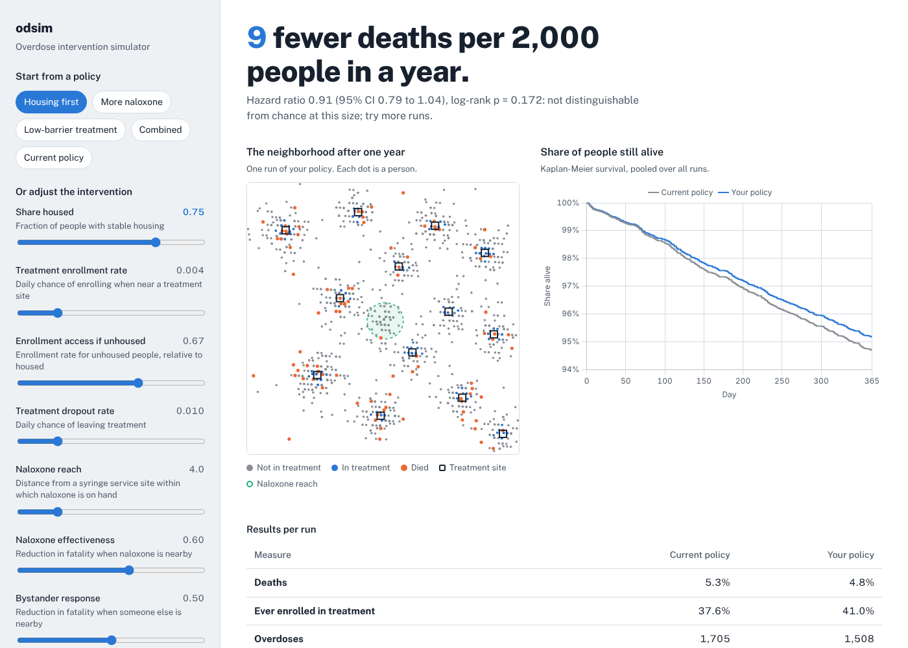
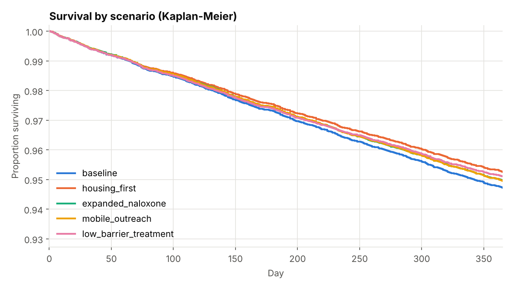
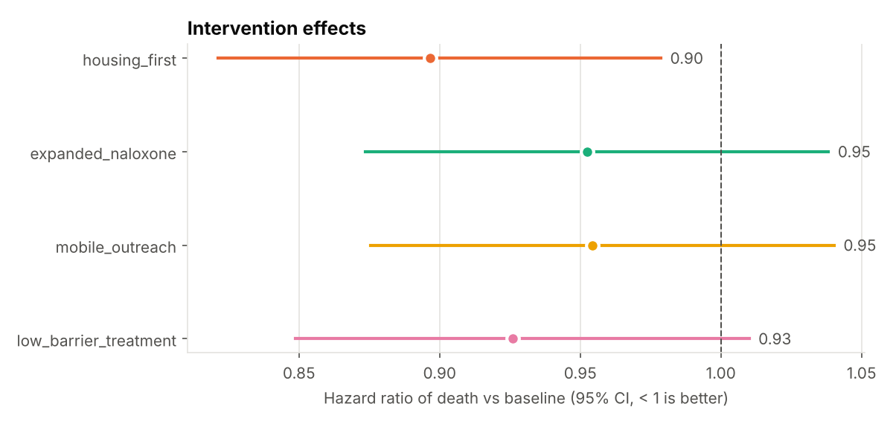

# odsim

**Live demo:** https://odsim.onrender.com

A fast agent-based simulation of overdose risk and treatment access, with the statistics to evaluate public-health interventions built in: Kaplan-Meier and log-rank tests, Cox proportional hazards regression, Bayesian calibration with ABC-SMC, and an interactive web dashboard.



People in the model move around a neighborhood that contains treatment sites and a syringe service program (SSP). Each day a person may enroll in or leave treatment, and may overdose. An overdose is less likely to be fatal near an SSP (naloxone on hand) or when someone else is nearby (a witnessed overdose). Housing status raises overdose risk and lowers access to treatment. Running many replicates of each policy and comparing survival shows which interventions reduce deaths, by how much, and how confident we can be.

The model structure is adapted from my NetLogo model of Kensington, Philadelphia (Penn PURM research). The parameters and site layout in `examples/` are illustrative, not calibrated to real data.

## Highlights

- **1 million agents for a simulated year in 26 s** on a 2-core machine, using a Numba-compiled, multi-threaded engine (2.5x faster than the vectorized NumPy engine, 70x faster than a plain Python loop at 10k agents).
- **Three engines, one specification.** A readable per-agent loop defines the rules; the NumPy and Numba engines are tested against it for exact, step-by-step equality of every agent's state.
- **Agent interactions in O(N + cells)** via spatial hashing instead of O(N²) pairwise checks.
- **Survival statistics from scratch** (Kaplan-Meier, log-rank, Cox regression with Efron ties), validated against `lifelines` to 4+ significant figures.
- **Bayesian calibration** with ABC-SMC: infers model parameters from observed statistics, with credible intervals. A parameter-recovery test checks that it finds known true values.
- **Reproducible parallelism:** bit-identical results for any number of worker processes.
- **Web dashboard** (FastAPI) with request validation, size limits and caching, packaged as a Docker image with a container smoke test in CI.

## Quick start

```bash
pip install -e ".[dev]"
pytest                      # 80+ tests

odsim serve                 # dashboard at http://127.0.0.1:8000
```

## Command line

```bash
# Compare intervention scenarios: log-rank tests and Cox hazard ratios vs baseline
odsim compare examples/config.json examples/scenarios.json --reps 20

# The same comparison as a self-contained HTML report with figures
odsim report examples/config.json examples/scenarios.json --reps 20 --html report.html

# Grid search over parameters, with a heatmap
odsim sweep examples/config.json --param p_enroll=0.002,0.004,0.008 \
    --param frac_housed=0.3,0.5,0.7 --reps 10 --heatmap sweep.png

# Infer parameters from observed statistics
odsim calibrate examples/config.json examples/calibration.json --particles 200 --out posterior.csv

# Any command can use the compiled engine
odsim run examples/config.json --reps 4 --backend numba
```

## Results on the example scenarios

20 replicates x 2,000 people x 365 days per scenario:




## Calibration

Agent-based models have no likelihood function, so standard Bayesian inference does not apply. ABC replaces the likelihood with simulation: propose parameters, simulate, and keep proposals whose simulated statistics land close to the observed ones. ABC-SMC refines the proposals over several generations with a shrinking tolerance and importance weights.

`examples/calibration.json` holds statistics generated from known parameters, so the answer can be checked:

| parameter | true value | posterior mean | 90% credible interval |
|---|---|---|---|
| `p_overdose` | 0.0025 | 0.0025 | 0.0019 to 0.0031 |
| `p_enroll` | 0.0060 | 0.0065 | 0.0042 to 0.0092 |

(100 particles, 4 generations, about 1,200 simulations, 100 s on 2 cores.)

## Design

```
src/odsim/
  config.py          validated, immutable SimConfig; JSON loading; scenario overrides
  model.py           Simulation, NumPy engine, spatial hashing, reference loop
  _numba_kernels.py  compiled, parallel engine
  survival.py        Kaplan-Meier estimator and log-rank test
  cox.py             Cox proportional hazards (Newton-Raphson, Efron ties)
  experiments.py     parallel replicates, sweeps, scenario comparison
  calibrate.py       ABC-SMC parameter inference
  report.py          figures and HTML report
  cli.py             odsim run | sweep | compare | report | calibrate | serve
  web/               FastAPI app and dashboard
```

**Struct-of-arrays state.** Each agent attribute is one NumPy array, so a step is a fixed number of array operations whatever the population size, and the memory layout suits both vectorization and compiled loops.

**Precomputed spatial fields.** At startup the model computes, for every grid cell, the distance to the nearest treatment site and SSP and the location of the nearest site, so agents look these up in O(1).

**Spatial hashing for interactions.** Whether an overdose is witnessed depends on who is nearby. Living agents are hashed to grid cells with one `bincount`, and 3x3 neighborhood counts come from nine shifted array additions: O(N + cells) rather than comparing every pair.

**Randomness separated from rules.** All random numbers for a step are drawn up front into a `StepDraws` object. That is what lets three implementations be compared draw for draw, and it keeps the Numba kernels deterministic under multithreading (each thread only writes its own agents).

**Reproducible parallelism.** Replicates and calibration simulations run in a process pool, each with its own child of one `SeedSequence`. Results do not depend on worker count. Scenario comparisons reuse seeds across scenarios (common random numbers), which reduces noise in the differences.

**Statistics.** Cox regression maximizes Efron's partial likelihood by Newton-Raphson with step halving. Risk-set sums come from reverse cumulative sums over time-sorted agents, so each iteration is roughly linear in the number of agents.

## Performance

`python benchmarks/benchmark.py`, with agent interactions on, 500x500 grid, 2 cores:

| agents | per-agent loop | NumPy | Numba |
|---|---|---|---|
| 1,000 | 4.2 ms/step | 2.5 ms/step | 0.26 ms/step |
| 10,000 | 43 ms/step | 4.6 ms/step | 0.61 ms/step |
| 100,000 | | 19 ms/step | 2.6 ms/step |
| 1,000,000 | | 138 ms/step | 19 ms/step |

At large sizes, generating random numbers becomes the bottleneck for the Numba engine (58 ms per step end to end at 1M agents).

## Testing

- Every engine matches the reference loop exactly, with and without agent interactions.
- Spatial hashing matches a brute-force neighbor count.
- Kaplan-Meier, log-rank and Cox results match hand calculations and `lifelines`.
- Cox regression recovers known coefficients from simulated data.
- Calibration recovers known parameters within its credible intervals.
- Parallel runs equal serial runs.
- The API rejects out-of-range or oversized requests.
- CI runs the suite on Python 3.10 to 3.12, then builds and smoke-tests the Docker image.

## Deploying the dashboard

The repo includes a `Dockerfile` and a `render.yaml`. On [Render](https://render.com): New, then Blueprint, then pick this repo. Any Docker host works; the server reads the port from `$PORT`. `ODSIM_MAX_AGENTS` and `ODSIM_MAX_REPS` cap request size.

## Model rules (per person, per day)

1. **Move** (if alive and not in treatment): with probability `p_seek` step toward the nearest site, otherwise a random step.
2. **Treatment:** within `enroll_radius` of a treatment site, enroll with probability `p_enroll` (times `unhoused_enroll_mult` if unhoused). People in treatment leave with probability `p_dropout`.
3. **Overdose** with probability `p_overdose`, times `treatment_od_mult` if in treatment and `unhoused_od_mult` if unhoused.
4. **Death:** an overdose is fatal with probability `p_fatal`, reduced by `naloxone_effect` within `naloxone_radius` of an SSP and by `bystander_effect` if anyone else is in the same or an adjacent cell.

## License

MIT. The dashboard bundles Chart.js (MIT) and Public Sans (SIL Open Font License); licenses are in `src/odsim/web/static/vendor/`.
